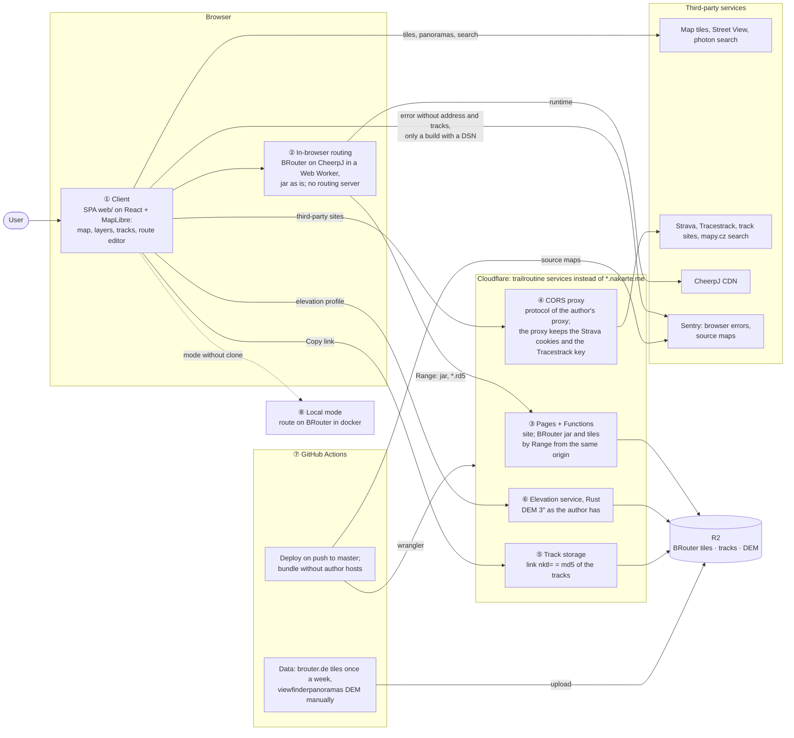
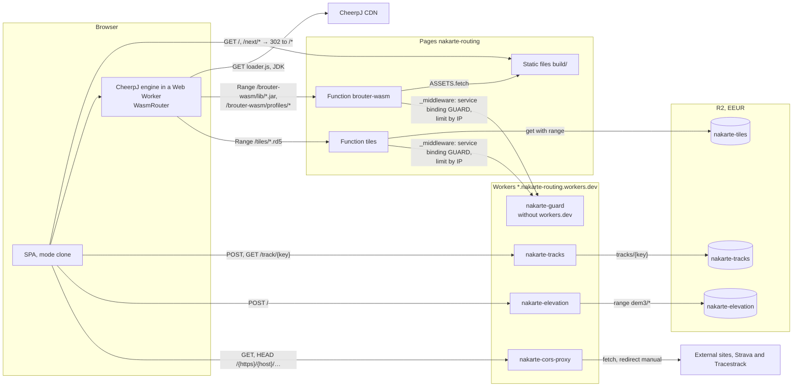
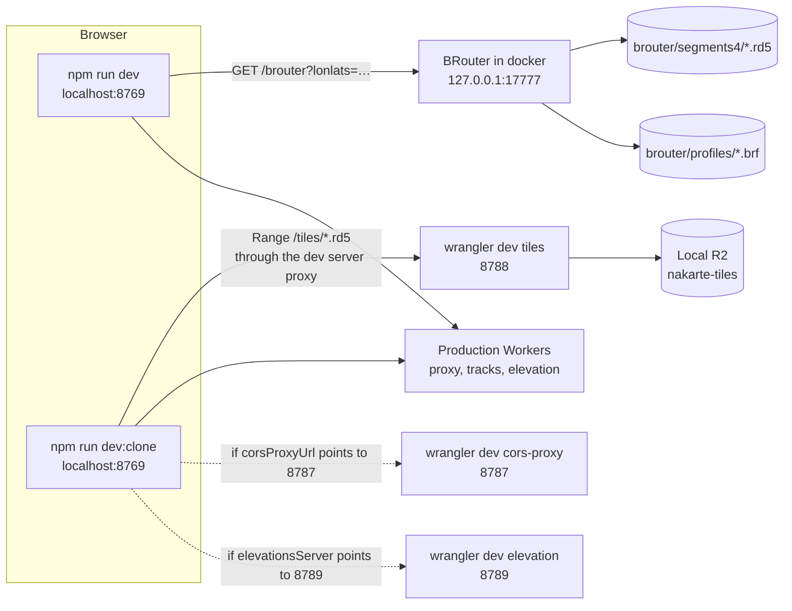

# Architecture

This document shows the app from the top down. First, it gives the full system as large blocks with the key decisions. Then it shows each block separately. The document shows structure and connections. For all other facts, it links to the place that records them (`AGENTS.md`, section ["Where each fact is recorded"](../../AGENTS.md#где-что-записано)). Behavior is in `openspec/specs/`. The reasons for decisions are in the change archive and the [decision register](decisions.md). Launch and pitfalls are in `AGENTS.md`, and risks are in `openspec/backlog.md`.

The diagrams were checked against the code on `master` on 2026-10-09 (after change `switch-to-web-app`), and the Workers after change `retire-old-client-services`. When you change a connection in the code, change the arrow here.

## Overview

What the system contains, where each part runs, and which decisions give the system its shape. Each block number leads to the table below the diagram.

| Block | Key decision | Details | Reason |
|---|---|---|---|
| ① Client | the app `web/` is on `/` (the old nakarte client is deleted, `/next/` is a redirect); the service addresses are the same in all modes, and mode `clone` changes only the engine ([switch-to-web-app](../../openspec/changes/archive/2026-10-09-switch-to-web-app/design.md)) | [client.md](client.md), [route-editor.md](route-editor.md) | [register: platform and stack](decisions.md#platform-and-stack), [editor](decisions.md#editor) |
| ② In-browser routing | BRouter on CheerpJ in a Web Worker of the page calculates the route; the server only serves files | [routing.md](routing.md) | [register: routing and the engine](decisions.md#routing-and-the-in-browser-engine) |
| ③ Pages + Functions | BRouter jar, profiles and tiles come from the trailroutine origin by Range: CheerpJ reads only this origin | [routing.md](routing.md), [level 2](#public-site) | [register: routing and the engine](decisions.md#routing-and-the-in-browser-engine) |
| ④ CORS proxy | repeats the protocol of the author's proxy; the proxy gets the Strava heatmap cookies itself from a session, and the key for the default Tracestrack basemap from its own secret | [cors-proxy.md](cors-proxy.md) | [register: CORS proxy and Strava](decisions.md#cors-proxy-and-strava) |
| ⑤ Track storage | the link `nktl=` is the md5 of the tracks, and the object in R2 does not change | [track-storage.md](track-storage.md) | [register: track storage](decisions.md#track-storage) |
| ⑥ Elevation service | the data and arithmetic of the author, Rust → wasm; only the elevation API, the elevation tiles are retired | [elevation.md](elevation.md) | [register: elevation service](decisions.md#elevation-service) |
| ⑦ GitHub Actions | production = `master`; CI uploads the data to R2, not the runtime; the deploy fails on author hosts | [ci-cd.md](ci-cd.md), [protection.md](protection.md) | [register: deploy and protection](decisions.md#deploy-and-protection) |
| ⑧ Local mode | the same app in a mode without `clone`: `routingEngine: 'server'` and BRouter in docker | [level 2](#local-mode), [routing.md](routing.md) | `AGENTS.md`, ["Launch"](../../AGENTS.md#запуск) |
| Cloudflare as a whole | own Workers and R2 instead of `*.nakarte.me`, with per-call and rate limits | [protection.md](protection.md), [what is replaced](#replaced-nakarteme-services) | [register: platform and stack](decisions.md#platform-and-stack) |

Which third-party services the system depends on, and what breaks when each one fails: [backlog, "External dependencies and risks"](../../openspec/backlog.md#внешние-зависимости-и-риски).

## Level 2: containers and requests

The blocks of the overview one level down: each service and each request path with its protocol. There are two diagrams: the public site and local mode. There is one client and two build modes; [client.md](client.md) tells how they are different.

### Public site

The build `vite build --mode clone` on `nakarte-routing.pages.dev`. The browser calculates the route, and the BRouter tiles and engine files come from the same origin.

Cloudflare resources, the account and the addresses: `AGENTS.md`, ["Public site on Cloudflare"](../../AGENTS.md#публичный-клон-на-cloudflare).

### Local mode

The `web/` dev server on 8769: `npm run dev` uses BRouter in docker, and `npm run dev:clone` uses the in-browser engine. You need local Workers only to check changes in them: by default, the app sends requests to the production Workers (addresses: [config.ts](../../web/src/config.ts)).

The dev server and `vite preview` serve the engine files with Range themselves ([engine-files.ts](../../web/vite/engine-files.ts)): `/brouter-wasm/lib`, `profiles`, and, without `clone`, also the tiles `/brouter-wasm/segments4/` from `brouter/segments4/`. Launch, ports and pitfalls: `AGENTS.md`, ["Launch"](../../AGENTS.md#запуск) and ["Public site on Cloudflare"](../../AGENTS.md#публичный-клон-на-cloudflare).

## Replaced `*.nakarte.me` services

No function of trailroutine sends requests to the author's infrastructure (requirement ["No requests to the author's infrastructure"](../../openspec/specs/clone-hosting/spec.md#requirement-без-запросов-к-инфраструктуре-автора) in clone-hosting). The deploy checks this in the bundle ([protection.md](protection.md)).

| Author service | Replacement | Source |
|---|---|---|
| `proxy.nakarte.me` | `nakarte-cors-proxy` | [cors-proxy](../../openspec/specs/cors-proxy/spec.md), [drop-author-services](../../openspec/changes/archive/2026-10-08-drop-author-services/design.md) |
| `proxy.nakarte.me/mapy/` (mapy.cz layers) | deleted, not replaced | [drop-author-services](../../openspec/changes/archive/2026-10-08-drop-author-services/design.md) |
| `tracks.nakarte.me` | `nakarte-tracks` | [track-storage](../../openspec/specs/track-storage/spec.md) |
| `elevation.nakarte.me` | `nakarte-elevation`, `POST /` | [elevation-api](../../openspec/specs/elevation-api/spec.md) |
| `tiles.nakarte.me/elevation` | not replaced: our elevation tiles are retired together with the old nakarte client | [retire-old-client-services](../../openspec/changes/archive/2026-10-09-retire-old-client-services/design.md), [elevation.md](elevation.md#elevation-tiles-are-retired) |
| `{s}.tiles.nakarte.me`, `tiles.nakarte.me/topomapper` (map scans), `nakarte.me/westraPasses/`, `nakarte.me/geocachingSu/` | layers deleted | [drop-author-scan-layers](../../openspec/changes/archive/2026-10-08-drop-author-scan-layers/design.md) |
| `tiles.nakarte.me/wikimedia_commons_images`, `mapillary.nakarte.me` (panorama coverage) | providers deleted, only Street View stays | [remove-panorama-providers](../../openspec/changes/archive/2026-10-08-remove-panorama-providers/design.md) |
| `nakarte.me/event`, Sentry | none: the app has no event log and no Sentry | [config.ts](../../web/src/config.ts), [drop-author-services](../../openspec/changes/archive/2026-10-08-drop-author-services/design.md) |

## Inventory

Each component and each connection, with the file that confirms it. All diagrams come from these tables. Use the tables as a reference to check the diagrams, not to read from start to end.

### Components

| Component | What it is | Evidence |
|---|---|---|
| Client | SPA `web/` on React + MapLibre, Vite build | [vite.config.ts](../../web/vite.config.ts), [App.tsx](../../web/src/App.tsx) |
| Mode without `clone` (server mode) | `makeConfig(mode)`: the route comes from the server BRouter | [config.ts](../../web/src/config.ts) |
| Mode `clone` | `vite build --mode clone`: in-browser engine, tiles from `/tiles/` | [config.ts](../../web/src/config.ts), [deploy-pages.yml](../../.github/workflows/deploy-pages.yml) |
| Pages project `nakarte-routing` | static files `build/` (the app in the root, the engine files in `brouter-wasm/`, the `/next/` redirect from `_redirects`) and Pages Functions, address `nakarte-routing.pages.dev` | [wrangler.toml](../../wrangler.toml), [_redirects](../../web/public/_redirects) |
| Pages Function `tiles` | BRouter tiles `/tiles/*` from R2 with Range; code in `workers/tiles` | [functions/tiles](../../functions/tiles/[[path]].js), [workers/tiles/src/index.js](../../workers/tiles/src/index.js) |
| Pages Function `brouter-wasm` | Range for the engine files (jar, profiles) on top of the Pages static files | [functions/brouter-wasm](../../functions/brouter-wasm/[[path]].js) |
| Worker `nakarte-guard` | rate counter for Pages Functions, closed from outside (`workers_dev = false`) | [workers/guard/wrangler.toml](../../workers/guard/wrangler.toml), [index.js](../../workers/guard/src/index.js), [client.js](../../workers/guard/src/client.js) |
| Worker `nakarte-cors-proxy` | CORS proxy, Strava heatmap cookies, Tracestrack key (`TRACESTRACK_KEY`) | [workers/cors-proxy/wrangler.toml](../../workers/cors-proxy/wrangler.toml), [index.js](../../workers/cors-proxy/src/index.js), [strava.js](../../workers/cors-proxy/src/strava.js), [tracestrack.js](../../workers/cors-proxy/src/tracestrack.js) |
| Worker `nakarte-tracks` | track storage for `nktl=` | [workers/tracks/wrangler.toml](../../workers/tracks/wrangler.toml), [index.js](../../workers/tracks/src/index.js) |
| Worker `nakarte-elevation` | elevation API (`POST /`), Rust → wasm; no elevation tiles | [workers/elevation/wrangler.toml](../../workers/elevation/wrangler.toml), [http.rs](../../workers/elevation/core/src/http.rs) |
| R2 `nakarte-tiles` | BRouter tiles `*.rd5`, sync `manifest.json` | [wrangler.toml](../../wrangler.toml), [brouter-tiles-sync.mjs](../../scripts/brouter-tiles-sync.mjs) |
| R2 `nakarte-tracks` | objects `tracks/{key}` | [workers/tracks/wrangler.toml](../../workers/tracks/wrangler.toml) |
| R2 `nakarte-elevation` | degree objects `dem3/N43E042`; the elevation tile archive `tiles/elevation-z0-9` stays until the owner decides, and the Worker does not read it | [grid.rs](../../workers/elevation/core/src/grid.rs), [elevation.md](elevation.md#elevation-tiles-are-retired) |
| BRouter in docker | `ghcr.io/abrensch/brouter:nightly` on `127.0.0.1:17777` | [docker-compose.yml](../../docker-compose.yml) |
| Dev server | 8769 for `npm run dev` and `npm run dev:clone` from `web/`, 4173 for `vite preview` | [web/package.json](../../web/package.json), [vite.config.ts](../../web/vite.config.ts), `../.claude/launch.json` (outside the repository) |
| In-browser engine | CheerpJ in a Web Worker + `brouter.jar` + patches + `WasmRouter` | [engine/](../../web/src/engine/), [build.sh](../../experiments/wasm/cheerpj/build.sh) |
| GitHub Actions | checks, deploy, data upload | [.github/workflows/](../../.github/workflows/) |

### Connections

| From → to | Protocol and path | Evidence |
|---|---|---|
| browser → Pages | `GET /`, static files of the build; `/next`, `/next/*` → `302` to the same path from the root | [wrangler.toml](../../wrangler.toml) (`pages_build_output_dir`), [_redirects](../../web/public/_redirects) |
| in-browser engine → `functions/brouter-wasm` | `Range /brouter-wasm/lib/*.jar`, `/brouter-wasm/profiles/*` | [cheerpj-router.ts](../../web/src/engine/cheerpj-router.ts) (`BASE_DIR`), [engine.worker.ts](../../web/src/engine/engine.worker.ts) |
| in-browser engine → `functions/tiles` | `Range /tiles/*.rd5`, empty `/tiles/storageconfig.txt` | [config.ts](../../web/src/config.ts) (`routingTilesPath`), [workers/tiles/src/index.js](../../workers/tiles/src/index.js) (`EMPTY_FILES`) |
| `functions/tiles` → R2 `nakarte-tiles` | `TILES.get(key, {range})`, `TILES.head` | [workers/tiles/src/index.js](../../workers/tiles/src/index.js) |
| `functions/*/_middleware.js` → `nakarte-guard` | `GUARD.fetch` with `X-Client-IP`, response `204` or `429` | [client.js](../../workers/guard/src/client.js), [wrangler.toml](../../wrangler.toml) (`[[services]]`) |
| browser → CheerpJ CDN | `GET https://cjrtnc.leaningtech.com/4.3/loader.js`, then the JDK in parts | [config.ts](../../web/src/config.ts) (`routingEngineRuntimeUrl`) |
| browser → BRouter in docker | `GET http://localhost:17777/brouter?lonlats=…&profile=…&format=geojson` | [router.ts](../../web/src/routing/router.ts), [brouter.ts](../../web/src/routing/brouter.ts), [config.ts](../../web/src/config.ts) (`routingServer`) |
| browser → `nakarte-tracks` | `POST /track/{key}`, `GET /track/{key}` | [share.ts](../../web/src/tracks/share.ts), [links.ts](../../web/src/tracks/links.ts) |
| `nakarte-tracks` → R2 `nakarte-tracks` | `head`/`put`/`get` `tracks/{key}` | [workers/tracks/src/index.js](../../workers/tracks/src/index.js) |
| browser → `nakarte-elevation` | `POST /` (one point per line) | [api.ts](../../web/src/elevation/api.ts) |
| `nakarte-elevation` → R2 `nakarte-elevation` | range reads of `dem3/*` | [worker/src/lib.rs](../../workers/elevation/worker/src/lib.rs), [grid.rs](../../workers/elevation/core/src/grid.rs) |
| browser → `nakarte-cors-proxy` | `GET`/`HEAD /{http,https}/{host}/{path}` | [catalog.ts](../../web/src/layers/catalog.ts), [sources.ts](../../web/src/tracks/sources.ts), [mapycz.ts](../../web/src/search/mapycz.ts), [links.ts](../../web/src/search/links.ts) |
| `nakarte-cors-proxy` → external sites | `fetch(target, {redirect: 'manual'})` | [cors-proxy/src/index.js](../../workers/cors-proxy/src/index.js) (`proxy`) |
| `nakarte-cors-proxy` → Tracestrack | tiles `tile.tracestrack.com/topo_<language>/…` (label language: the browser language or English) with `key` from the secret `TRACESTRACK_KEY` | [tracestrack.js](../../workers/cors-proxy/src/tracestrack.js) |
| `nakarte-cors-proxy` → Strava | `GET www.strava.com/maps/global-heatmap`, tiles `content-*.strava.com`, `heatmap-external-{a,b,c}.strava.com` | [strava.js](../../workers/cors-proxy/src/strava.js) |
| browser → tile providers | `GET` of tiles directly (most layers) | [catalog.ts](../../web/src/layers/catalog.ts) |
| browser → OpenFreeMap | `GET /planet` (TileJSON), then the vector tiles `/planet/<build>/{z}/{x}/{y}.pbf` of the basemap `Of`; no fonts and no sprites | [catalog.ts](../../web/src/layers/catalog.ts) (`OPENFREEMAP_TILEJSON`), [outdoor.ts](../../web/src/layers/outdoor.ts) |
| browser → Earth Search (Element 84) | `GET /v1/search` for the Sentinel-2 and Landsat capture dates above the map center (dated imagery `Hls`) | [dated.ts](../../web/src/layers/dated.ts) |
| browser → photon.komoot.io | `GET /api/` of the search (fallback for mapy.cz) | [photon.ts](../../web/src/search/photon.ts) |
| browser → Google | Maps JavaScript API for Street View, coverage tiles | [google.ts](../../web/src/streetview/google.ts), [coverage.ts](../../web/src/streetview/coverage.ts) |
| dev server 8769 → `wrangler dev` of tiles 8788 | proxy for `/tiles/` | [vite.config.ts](../../web/vite.config.ts) (`server.proxy`) |
| GitHub Actions → Cloudflare | `wrangler pages deploy`, `wrangler deploy`, Pages API (deletion of old deploys), R2 S3 API (BRouter tiles and elevations) | [ci-cd.md](ci-cd.md) |

## Checked against

[web/src/config.ts](../../web/src/config.ts), [web/vite.config.ts](../../web/vite.config.ts), [web/public/_redirects](../../web/public/_redirects), [wrangler.toml](../../wrangler.toml), `workers/*/wrangler.toml`, [functions/](../../functions/), [workers/](../../workers/), [.github/workflows/](../../.github/workflows/), [docker-compose.yml](../../docker-compose.yml), [web/src/engine/](../../web/src/engine/), [web/src/routing/](../../web/src/routing/), [web/src/layers/catalog.ts](../../web/src/layers/catalog.ts), [web/src/search/](../../web/src/search/).
