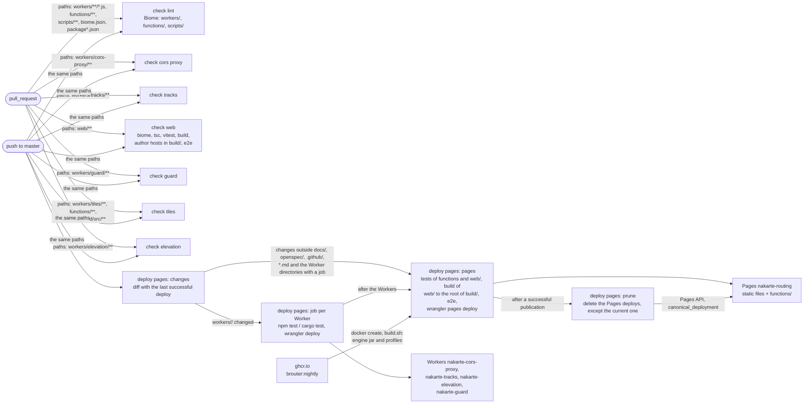
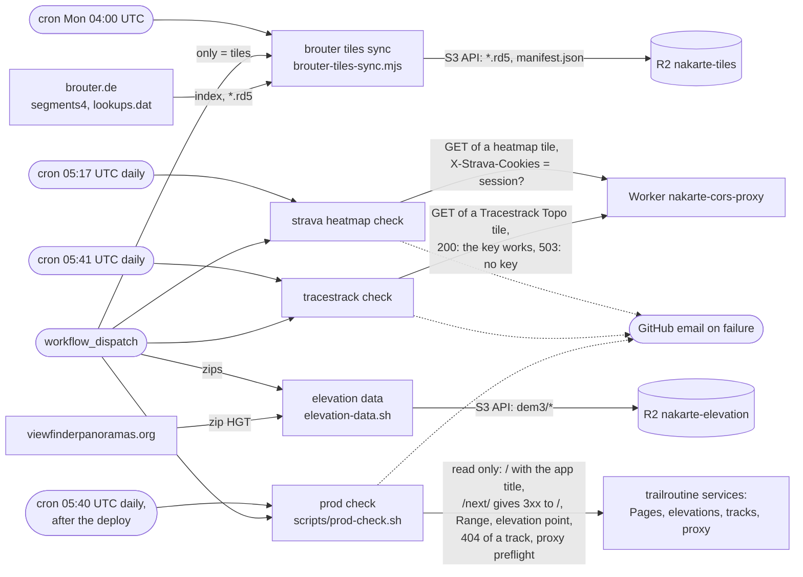

# CI/CD and data

One level up: [overview](README.md#overview), block ⑦.

All workflows are in [.github/workflows/](../../.github/workflows/). The checks run on a PR and on a push to `master`. The deploy runs on a push to `master` and deploys only the changed services. The data upload runs on a schedule or manually. The deploy behavior is in the spec [clone-deploy](../../openspec/specs/clone-deploy/spec.md), the tile sync behavior is in [tile-sync](../../openspec/specs/tile-sync/spec.md). The manual deploy as a fallback: `AGENTS.md`, ["Public site on Cloudflare"](../../AGENTS.md#публичный-клон-на-cloudflare).

## Checks and deploy

The job `changes` in [deploy-pages.yml](../../.github/workflows/deploy-pages.yml) compares `HEAD` with the commit of the last successful run of `deploy pages`, not with the previous push. Thus the next run deploys the changes of a run that failed or that a new push cancelled (`cancel-in-progress`). A manual run, a change of this workflow, or an unknown base deploys everything. A change of other workflows, `docs/`, `openspec/` and `*.md` does not deploy Pages.

The job of each Worker runs the tests of the service and deploys it. The job `pages` runs after these jobs, and does not run if a Worker deploy fails. After each successful publication, also when the Worker jobs are skipped, the job `prune` deletes all Pages deploys except the current one. It does this only if the current deploy is built from the commit of the run. An old deploy would answer on `<hash>.nakarte-routing.pages.dev` with its own functions and without the new limits. To roll back Pages, revert and push.

The steps of `pages`:

1. Tests of the Pages Functions.
2. Engine files from the image (`build.sh`).
3. The app from `web/`: `npm ci` and Playwright Chromium, `npm test`, `npm run build`. The build is `vite build --mode clone` to the root of `build/`, and the plugin `engineFiles` puts the engine jar and profiles there. Only this step gets the Google key and the Sentry DSN.
4. A check that the engine files are in the build.
5. Sentry Debug IDs in `build/assets` (`sentry-cli sourcemaps inject`, without a token).
6. e2e on this build.
7. Upload of the source maps to Sentry (`sentry-cli sourcemaps upload`). Only this step gets the token, and without the token the step is skipped.
8. Deletion of `build/**/*.map`, with a check.
9. A check of the bundle for author hosts ([protection.md](protection.md)).
10. Publication of Pages.

The deploy does not wait for the `check-<service>` checks: the job of each Worker and the job `pages` run the necessary tests themselves. Before the merge, `check web` does the same bundle check (`../build`).

The BRouter tiles (`workers/tiles`) do not deploy as a separate Worker. Their code is connected as the Pages Function [functions/tiles](../../functions/tiles/[[path]].js) and deploys with Pages. Only the local `wrangler dev` needs [workers/tiles/wrangler.toml](../../workers/tiles/wrangler.toml).

## Data and monitoring

| Workflow | When | What it does | Target |
|---|---|---|---|
| `check lint` | PR and push with changes in `workers/**/*.js`, `functions/`, `scripts/`, `biome.json`, the root `package.json` and `package-lock.json` | `npm run lint` from the root: Biome with the root `biome.json`, linter only | — |
| `check cors proxy`, `check tracks`, `check guard`, `check tiles` | PR and push with changes in the service directory (`check tiles` also in `functions/` and `workers/guard/src/`) | `vitest` in `workerd` | — |
| `check web` | PR and push with changes in `web/` and `scripts/check-no-author-hosts.mjs` | `biome ci`, `tsc -b`, Vitest (unit in Node and browser mode in Chromium), build to `build/`, check of `build/` for author hosts, Playwright e2e against `vite preview` | — |
| `check elevation` | PR and push with changes in `workers/elevation/` | `cargo fmt`, `clippy` (also for wasm32), `cargo test`, `npm test` in `workerd` | — |
| `deploy pages` | push to `master` (changed services), manually (everything) | tests of the service, build of `web/` and deploy; after Pages, deletion of the old Pages deploys and `prod check` (job `smoke`) | Pages, Workers |
| `brouter tiles sync` | Monday 04:00 UTC, manually | incremental sync of the tiles | R2 `nakarte-tiles` |
| `elevation data` | manually | repack of HGT to `dem3/*` | R2 `nakarte-elevation` |
| `strava heatmap check` | daily 05:17 UTC, manually | a heatmap tile through the proxy; fails without `session` | — |
| `tracestrack check` | daily 05:41 UTC, manually | a Tracestrack Topo tile through the proxy: `503` (no key) is a warning, another failure (key, quota) fails the workflow | — |
| `prod check` | daily 05:40 UTC, after the deploy (job `smoke`), manually | `scripts/prod-check.sh`: the app on `/`, the redirect from `/next/` to `/`, the trailroutine services respond; read only | — |

The workflow `elevation tiles` (the elevation tile archive z0–9) is deleted together with the elevation tiles: [elevation.md](elevation.md#elevation-tiles-are-retired). GitHub runs schedules only from the default branch. The workflows that write to Cloudflare and R2 have the condition `github.repository == 'sergeycw/trailroutine'`: a copy in another repository does not run them.

## Secrets

| Secret | Where it is | Who uses it | Permissions |
|---|---|---|---|
| `CLOUDFLARE_API_TOKEN` | GitHub | the steps `wrangler` and `prune` in `deploy pages` | Account API token "nakarte deploy": Pages Write, Editor on `nakarte-cors-proxy`, `nakarte-tracks`, `nakarte-elevation`, `nakarte-guard`; no R2 |
| `CLOUDFLARE_ACCOUNT_ID` | GitHub | the steps `wrangler` and `prune` in `deploy pages` | — |
| `GOOGLE_MAPS_API_KEY` | GitHub, optional | the step `web build` in `deploy pages`, variable `VITE_GOOGLE_MAPS_API_KEY`; without the secret, the key is empty and the app uses the keyless mode | key restrictions in Google Cloud (the key is in the bundle) |
| `R2_ACCESS_KEY_ID`, `R2_SECRET_ACCESS_KEY` | GitHub | `elevation data`, `brouter tiles sync` (R2 S3 API) | Bucket Item Write on `nakarte-elevation` and `nakarte-tiles` |
| `STRAVA_SESSION`, `STRAVA_COOKIES` | secrets of the Worker `nakarte-cors-proxy` | the proxy ([cors-proxy.md](cors-proxy.md)) | — |
| `TRACESTRACK_KEY` | secret of the Worker `nakarte-cors-proxy` | the proxy, tiles of the Tracestrack Topo basemap ([cors-proxy.md](cors-proxy.md#tracestrack-key)) | Tracestrack key without a `Referer` list; the free plan gives 100 thousand tiles per month |

Only the steps that use a secret get it (`env` of the step, not of the job): dependency install, tests and build run without secrets. In all workflows, actions are pinned to a full SHA. In the steps with a token, `wrangler` has the exact version from the variable `WRANGLER` (requirement ["Secrets only for the publication steps"](../../openspec/specs/clone-deploy/spec.md#requirement-секреты-только-у-шагов-публикации), [clone-deploy](../../openspec/specs/clone-deploy/spec.md)). The owner adds all secrets; the agent does not enter tokens. Token permissions and the order to add them: `AGENTS.md`, ["Public site on Cloudflare"](../../AGENTS.md#публичный-клон-на-cloudflare) and ["Elevation service"](../../AGENTS.md#сервис-высот-workerselevation). A token leak and narrower permissions: [security audit](../../openspec/research/security-audit.md), [item 5](../../openspec/research/security-audit.md#5-секреты-и-права) and ["Owner steps"](../../openspec/research/security-audit.md#шаги-владельца).

## Checked against

[.github/workflows/](../../.github/workflows/) (all thirteen files), [scripts/brouter-tiles-sync.mjs](../../scripts/brouter-tiles-sync.mjs), [workers/elevation/scripts/](../../workers/elevation/scripts/), [scripts/prod-check.sh](../../scripts/prod-check.sh), [experiments/wasm/cheerpj/build.sh](../../experiments/wasm/cheerpj/build.sh), [web/vite/engine-files.ts](../../web/vite/engine-files.ts), [functions/tiles](../../functions/tiles/[[path]].js), [workers/tiles/wrangler.toml](../../workers/tiles/wrangler.toml).
