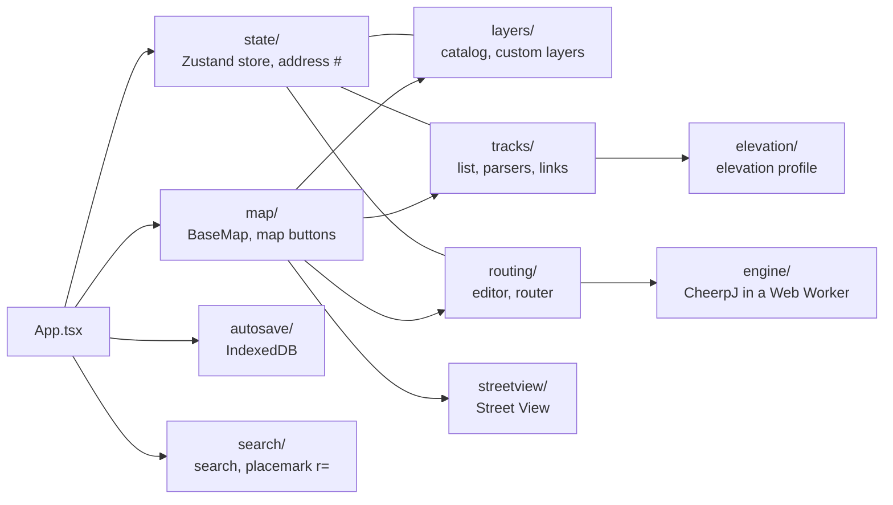
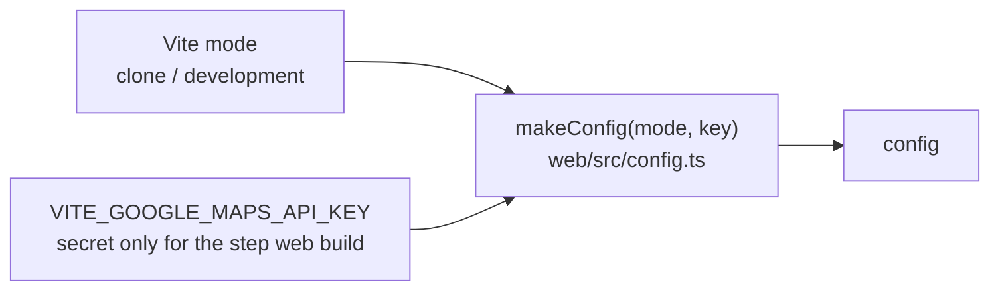

# Client

One level up: [overview](README.md#overview), block ①.

A single-page app in [web/](../../web/). The stack: React 19, MapLibre GL JS 6 through `@vis.gl/react-maplibre`, shadcn/ui on Base UI and Tailwind 4, state in Zustand, build with Vite. The app opens on `https://nakarte-routing.pages.dev/`. The address `/next/` (the address before the switch) answers with a redirect to the same path from the root ([web/public/_redirects](../../web/public/_redirects)). The entry point is [main.tsx](../../web/src/main.tsx), the root component is [App.tsx](../../web/src/App.tsx). Change `switch-to-web-app` deleted the old nakarte client (Leaflet, knockout, webpack). The reasons and the migration: [new UI research](../../openspec/research/new-ui.md) and the archives of changes 1–9 from its list.

## Main modules

The `web/src/` directories with their own logic or network access. Each directory keeps pure modules without React and the map (parsing, model, requests) apart from the components. The store connects the components and the map. The diagram does not show the helper directories (`components/ui` of shadcn, `lib/`, `test/`).

| Directory | Sends requests to | Details |
|---|---|---|
| `state/` | `location.hash`, `localStorage` | `hash.ts` parses the address parameters of the old nakarte client (`m=`, `l=`, `r=`, `n2=` …), `sync.ts` connects store ↔ address ↔ `localStorage`; spec [web-client](../../openspec/specs/web-client/spec.md) |
| `layers/` | tile providers directly; the vector basemap OpenFreeMap Outdoor (`Of`): TileJSON and tiles from `tiles.openfreemap.org` directly, with its own style and labels ([outdoor.ts](../../web/src/layers/outdoor.ts)); Strava, Tsvetkov (`Mt`), the default basemap Tracestrack Topo (`Tt`, the key is in the proxy, on an error the app falls back to OSM) and custom layers with the proxy flag go through `corsProxyUrl`; `maplibre-contour` builds the contour lines (`Ct`) in the browser, in its own Web Worker, from the AWS Terrain Tiles relief tiles, the same tiles as the hillshade `Hs` uses; dated imagery (`Hls`): HLS NASA GIBS tiles for the date from `d=`, capture dates with cloud cover from STAC Earth Search ([dated.ts](../../web/src/layers/dated.ts)) | spec [map-layers](../../openspec/specs/map-layers/spec.md), [cors-proxy.md](cors-proxy.md) |
| `tracks/` | `tracksStorageServer` (`nktl=`, "Copy link"), track sites through `corsProxyUrl` | [track-storage.md](track-storage.md), specs [tracks](../../openspec/specs/tracks/spec.md), [track-files](../../openspec/specs/track-files/spec.md) |
| `routing/` | the server BRouter (`routingServer`) or `engine/` | [route-editor.md](route-editor.md), [routing.md](routing.md) |
| `engine/` | the CheerpJ runtime from the Leaning Technologies CDN, `/brouter-wasm/` and `routingTilesPath` of the same origin | [routing.md](routing.md), spec [browser-routing-engine](../../openspec/specs/browser-routing-engine/spec.md) |
| `autosave/` | IndexedDB `nakarte-web`; reads `sessions` of the old nakarte client one time | archives `add-web-autosave`, `switch-to-web-app` |
| `elevation/` | `elevationsServer` (profile, GPX with elevations) | [elevation.md](elevation.md) |
| `search/` | mapy.cz and short links through `corsProxyUrl`, photon.komoot.io directly | spec [map-search](../../openspec/specs/map-search/spec.md) |
| `streetview/` | Google Maps JavaScript API, coverage tiles | spec [street-view](../../openspec/specs/street-view/spec.md) |
| `map/` | — | spec [web-client](../../openspec/specs/web-client/spec.md) |
| `errors/` | Sentry ingest (`o….ingest.sentry.io`): only for a build with `sentryDsn` and only with an error. The errors are unhandled exceptions, render errors, and an engine backend failure (`onBackendError` in `engine/`). The report has no address with `#…`, no request addresses and no console | spec [clone-monitoring](../../openspec/specs/clone-monitoring/spec.md), design [add-error-tracking](../../openspec/changes/archive/2026-10-30-add-error-tracking/design.md) |

The editor, the placemark and Street View share one map click handler: `routing/MapEditor.tsx` (`onClick`). On a phone, a long press opens the map menu ([route-editor.md](route-editor.md)).

## Service addresses

One module, [config.ts](../../web/src/config.ts), gives the addresses: `makeConfig(mode, googleMapsApiKey, sentryDsn)` from the Vite mode. Mode `clone` (`vite build --mode clone`, the script `build` and the deploy) turns on the in-browser engine. Any other mode (`npm run dev`) uses the server BRouter from `docker-compose.yml`. The Google key is the build variable `VITE_GOOGLE_MAPS_API_KEY`. The deploy gives the secret `GOOGLE_MAPS_API_KEY` only to the build step ([deploy-pages.yml](../../.github/workflows/deploy-pages.yml)). Without the key, the app uses the keyless mode.

| Field | Who reads it | Value in mode `clone` |
|---|---|---|
| `corsProxyUrl` | `layers/`, `tracks/`, `search/` | `https://nakarte-cors-proxy.nakarte-routing.workers.dev/` |
| `tracksStorageServer` | `tracks/` | `https://nakarte-tracks.nakarte-routing.workers.dev` |
| `elevationsServer` | `elevation/`, `tracks/` (GPX with elevations) | `https://nakarte-elevation.nakarte-routing.workers.dev/` |
| `routingEngine` | `routing/`, `App.tsx` | `'browser'` (in other modes `'server'`) |
| `routingEngineRuntimeUrl` | `engine/` | the CheerpJ 4.3 loader from `cjrtnc.leaningtech.com` |
| `routingServer` | `routing/` | `http://localhost:17777`, not used in mode `clone` |
| `routingTilesPath` | `engine/` | `'/tiles/'` (in other modes `'/brouter-wasm/segments4/'`) |
| `googleMapsApiKey` | `streetview/` | the secret or an empty string |
| `sentryDsn` | `errors/` | the secret `SENTRY_DSN` (`check-web` uses a fake DSN) or an empty string, which turns off the tracker |

## Build and serving

`vite build --mode clone` puts the app and the engine test bench (`engine-bench.html`) in the root of `build/`. The plugin `engineFiles` ([vite/engine-files.ts](../../web/vite/engine-files.ts)) adds the engine files to `build/brouter-wasm/`. The files of `web/public/` are copied as they are: `_redirects` and the site icons `favicon.svg`, `favicon.ico` and `apple-touch-icon.png` from [scripts/favicon.mjs](../../scripts/favicon.mjs). The build puts source maps next to the bundle files (`sourcemap: 'hidden'`, without a link in the bundle). The deploy uploads them to Sentry and deletes them before the publication. Pages publishes `build/` together with [functions/](../../functions/) ([ci-cd.md](ci-cd.md)).

## Checked against

[web/src/config.ts](../../web/src/config.ts), [web/src/App.tsx](../../web/src/App.tsx), [web/vite.config.ts](../../web/vite.config.ts), the directories `web/src/*/` (`grep -rhoE "config\.[A-Za-z]+" web/src`, `grep -rl "fetch(" web/src`), [deploy-pages.yml](../../.github/workflows/deploy-pages.yml): `master` after change `switch-to-web-app`.
