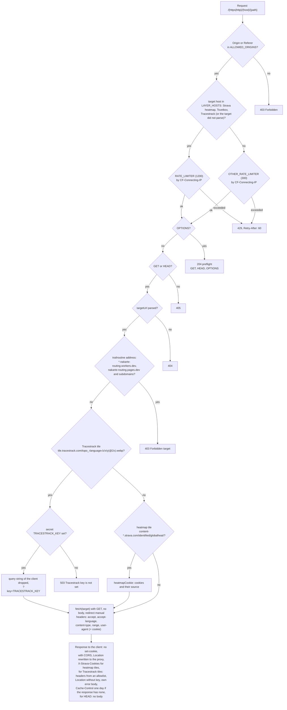
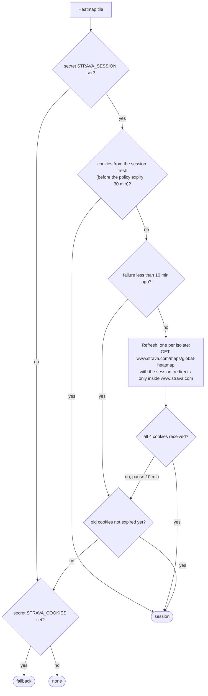
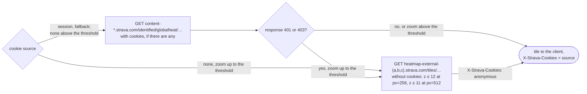

# CORS proxy and Strava heatmap

One level up: [overview](README.md#overview), block ④.

The Worker `nakarte-cors-proxy` ([workers/cors-proxy](../../workers/cors-proxy/)) repeats the protocol of the author's `proxy.nakarte.me`. The client adds the source URL to the proxy address (`viaCorsProxy` in [catalog.ts](../../web/src/layers/catalog.ts): `https://host/…` → `<proxy>https/host/…`). The proxy gets the response and returns it with CORS headers. These requests go through the proxy:

- track import from links ([sources.ts](../../web/src/tracks/sources.ts), `proxied`);
- mapy.cz search ([mapycz.ts](../../web/src/search/mapycz.ts)) and short link expansion ([links.ts](../../web/src/search/links.ts));
- the layers Tsvetkov (`Mt`), Strava heatmap and the default basemap Tracestrack Topo (`Tt`);
- custom layers with the proxy flag.

The shared layer limit (`LAYER_HOSTS`, 1200 per minute) applies only to the layer hosts that the app sends through the proxy. These hosts are Strava heatmap `content-*.strava.com`, Tsvetkov `maptiles.website.yandexcloud.net` and Tracestrack `tile.tracestrack.com`. Change [retire-old-client-services](../../openspec/changes/archive/2026-10-09-retire-old-client-services/design.md) removed the route `/wikimapia/` of the old nakarte client. The route answers `404`, as any path in an incorrect format does.

Behavior: spec [cors-proxy](../../openspec/specs/cors-proxy/spec.md); limits: [protection.md](protection.md).

## Request handling

The code is `fetch` and `proxy` in [index.js](../../workers/cors-proxy/src/index.js). Why the proxy only reads, blocks the trailroutine addresses and splits the limit by the host role: archive [restrict-cors-proxy](../../openspec/changes/archive/2026-10-08-restrict-cors-proxy/design.md). Why `HEAD` goes out as `GET` and why the proxy forwards `User-Agent`: archive [drop-author-services](../../openspec/changes/archive/2026-10-08-drop-author-services/design.md). The proxy still forwards `User-Agent` after Wikimapia left: some sites answer `403` without it, and `fetch` from a Worker does not set its own. The short links of mapy.com need `GET` instead of `HEAD`. Why `ALLOWED_ORIGINS` has the app dev server (8769) and `vite preview` (4173) instead of the origins of the old nakarte client and karma: design [retire-old-client-services](../../openspec/changes/archive/2026-10-09-retire-old-client-services/design.md).

## Tracestrack key

The default basemap of the app is the Tracestrack Topo raster. Tracestrack serves its tiles only with an API key. The key is the Worker secret `TRACESTRACK_KEY`, and the client does not know it. The layer address in [catalog.ts](../../web/src/layers/catalog.ts) has no `key`. The proxy adds the key only to the raster tiles `topo__` ([tracestrack.js](../../workers/cors-proxy/src/tracestrack.js)). Thus a request with a fake `Origin` cannot use the quota through the proxy for vector tiles and for API calls at 6 credits each.

The key does not go to the client. The tile headers come from an allowlist, `Location` has no `key`, and the proxy replaces the Tracestrack error body with its own. Without the secret, the proxy answers `503`, and the app falls back to OpenStreetMap with a toast. The app does the same on a Tracestrack `403` or `429` (key rejected, quota, limit). The daily workflow `tracestrack check` checks the key ([ci-cd.md](ci-cd.md)). Decisions and owner steps: design [add-outdoor-basemap](../../openspec/changes/archive/2026-10-09-add-outdoor-basemap/design.md). Behavior: spec cors-proxy, requirement ["Tracestrack key"](../../openspec/specs/cors-proxy/spec.md#requirement-ключ-tracestrack), and spec map-layers, requirement ["Basemap fallback on a tile error"](../../openspec/specs/map-layers/spec.md#requirement-откат-подложки-при-ошибке-тайлов).

## Strava heatmap cookies

CloudFront serves the tiles `content-*.strava.com/identified/globalheat/` only with the signed cookies of a signed-in account. The proxy keeps these cookies itself, and the client does not know about them. The proxy sends the cookie source of a tile in the header `X-Strava-Cookies` ([strava.js](../../workers/cors-proxy/src/strava.js), `heatmapCookie`).

What the proxy does with each source:

- The owner adds the Worker secrets `STRAVA_SESSION` and `STRAVA_COOKIES` with the scripts [strava-session-secret.mjs](../../scripts/strava-session-secret.mjs) and [strava-heatmap-secret.mjs](../../scripts/strava-heatmap-secret.mjs). The session and the cookies do not go to the log, and go nowhere except `www.strava.com` and the heatmap tiles.
- Once a day, the workflow `strava heatmap check` requests a tile through the proxy. It fails if `X-Strava-Cookies` is not `session` ([ci-cd.md](ci-cd.md)).
- Decisions: archives [add-strava-heatmap-refresh](../../openspec/changes/archive/2026-10-08-add-strava-heatmap-refresh/design.md) and [add-strava-anonymous-fallback](../../openspec/changes/archive/2026-10-08-add-strava-anonymous-fallback/design.md). How to update the secret, and diagnostics: `AGENTS.md`, ["Public site on Cloudflare"](../../AGENTS.md#публичный-клон-на-cloudflare). Session lifetime: [backlog, "Postponed"](../../openspec/backlog.md#отложено).

## Checked against

[workers/cors-proxy/src/index.js](../../workers/cors-proxy/src/index.js), [workers/cors-proxy/src/strava.js](../../workers/cors-proxy/src/strava.js), [workers/cors-proxy/wrangler.toml](../../workers/cors-proxy/wrangler.toml), [web/src/layers/catalog.ts](../../web/src/layers/catalog.ts) (`viaCorsProxy`), [web/src/layers/custom.ts](../../web/src/layers/custom.ts), [web/src/tracks/sources.ts](../../web/src/tracks/sources.ts), [web/src/search/mapycz.ts](../../web/src/search/mapycz.ts), [web/src/search/links.ts](../../web/src/search/links.ts), [strava-heatmap-check.yml](../../.github/workflows/strava-heatmap-check.yml).
