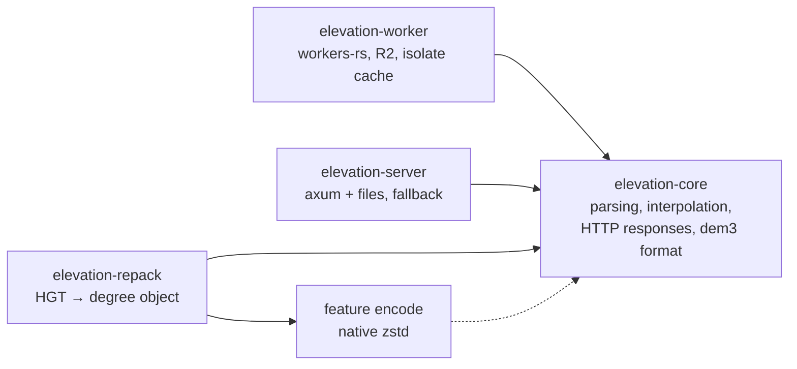
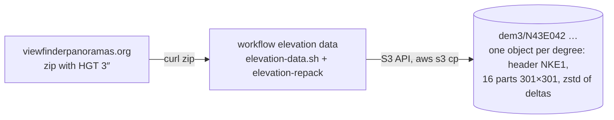
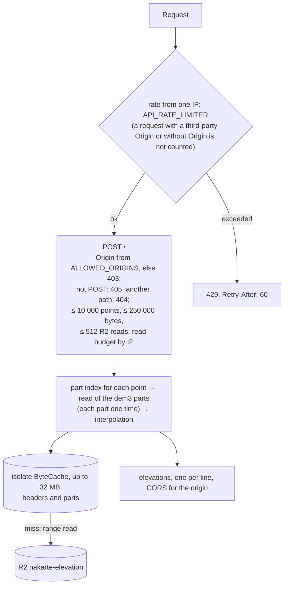

# Elevation service

One level up: [overview](README.md#overview), block ⑥.

The Worker `nakarte-elevation` ([workers/elevation](../../workers/elevation/)) answers one request: the elevation API (`POST /`, a list of points → elevations) for the track profile and the export. The data and the arithmetic are the same as the author's (DEM 3″ viewfinderpanoramas). Behavior: spec [elevation-api](../../openspec/specs/elevation-api/spec.md). Decisions: archive [add-elevation-api](../../openspec/changes/archive/2026-10-07-add-elevation-api/design.md). Build, checks and pitfalls: `AGENTS.md`, ["Elevation service"](../../AGENTS.md#сервис-высот-workerselevation). The elevation tiles do not exist anymore: section ["Elevation tiles are retired"](#elevation-tiles-are-retired).

## Rust workspace crates

- `core` has no I/O. The data source is the trait `Source`, which reads a byte range of an object ([lib.rs](../../workers/elevation/core/src/lib.rs)). Each adapter gives its own source: R2 in `worker`, files in `server`.
- In wasm, the decompression of the parts is pure Rust (`ruzstd`). The compression is the native `zstd` behind the feature `encode`, so only `repack` turns this feature on ([Cargo.toml](../../workers/elevation/repack/Cargo.toml)).
- `worker-build` builds `worker` to `worker/build/index.js` (`[build]` in [wrangler.toml](../../workers/elevation/wrangler.toml)).

## Data in R2 `nakarte-elevation`

The object format is in [format.rs](../../workers/elevation/core/src/format.rs) and [grid.rs](../../workers/elevation/core/src/grid.rs). The reason for this format: design `add-elevation-api`, ["Format: one object per degree, the author's parts"](../../openspec/changes/archive/2026-10-07-add-elevation-api/design.md#формат-объект-на-градус-куски-автора). Workflow and tokens: [ci-cd.md](ci-cd.md). The elevation tile archive `tiles/elevation-z0-9` in R2 stays until the owner decides, and the Worker does not read it.

## Request to the Worker

- The Cache API does not work on `*.workers.dev`, so the cache is in the isolate memory.
- Client: the API is in [web/src/elevation/api.ts](../../web/src/elevation/api.ts) (elevation profile, GPX with elevations; attribution `elevationsAttribution` in [config.ts](../../web/src/config.ts)), [client.md](client.md).

## Elevation tiles are retired

Only the old nakarte client showed the elevation tiles (`GET /tiles/{z}/{x}/{y}`: z0–9 from an archive, z10–11 on request). It used them for the elevation and the slope under the cursor. Change [retire-old-client-services](../../openspec/changes/archive/2026-10-09-retire-old-client-services/design.md) removed them, together with these items:

- the route `/tiles/`;
- the counter `TILES_RATE_LIMITER` (`namespace_id` `1001` is free);
- the tile calculation in the core;
- the archive generator `elevation-tiles`;
- the workflow `elevation tiles`.

`GET /tiles/…` is now a usual API request: without `Origin` it gets `403`, with an allowed `Origin` it gets `405`. The archive `tiles/elevation-z0-9` in R2 stays until the owner decides, and the Worker does not read it. How the tiles worked: archive [add-elevation-tiles](../../openspec/changes/archive/2026-10-07-add-elevation-tiles/design.md).

## Checked against

[workers/elevation/Cargo.toml](../../workers/elevation/Cargo.toml) and the `Cargo.toml` of the crates, [core/src/http.rs](../../workers/elevation/core/src/http.rs) (`handle`, `counts_toward_limit`), [core/src/request.rs](../../workers/elevation/core/src/request.rs) (`MAX_POINTS`, `MAX_BODY_BYTES`), [worker/src/lib.rs](../../workers/elevation/worker/src/lib.rs), [wrangler.toml](../../workers/elevation/wrangler.toml), [scripts/](../../workers/elevation/scripts/), [elevation-data.yml](../../.github/workflows/elevation-data.yml).
