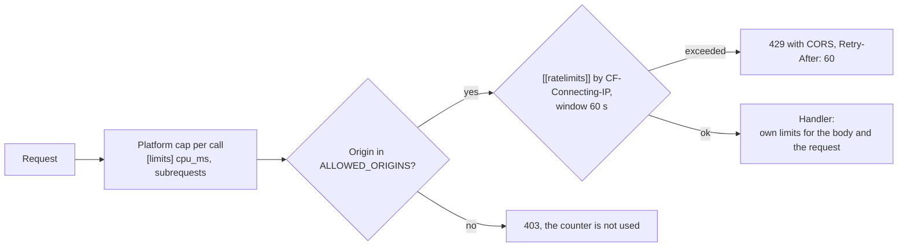
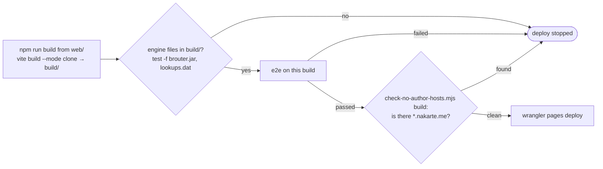

# Protection and limits

One level up: [overview](README.md#overview), block "Cloudflare" and ⑦.

What limits the load and the cost on Cloudflare, and what stops trailroutine from sending requests to the author's infrastructure. Behavior: specs [worker-limits](../../openspec/specs/worker-limits/spec.md) and clone-deploy, requirement ["Bundle without author hosts"](../../openspec/specs/clone-deploy/spec.md#requirement-бандл-без-адресов-автора); the CORS of each service is in its spec. Decisions and numbers: archive [add-worker-limits](../../openspec/changes/archive/2026-10-07-add-worker-limits/design.md). Rules for a new counter: `AGENTS.md`, ["Own backends instead of `*.nakarte.me`"](../../AGENTS.md#свои-бэкенды-вместо-nakarteme).

## Order of checks in a Worker

The proxy, the tracks and the elevations have the same `ALLOWED_ORIGINS`: the trailroutine site, the app dev server `localhost:8769` and `vite preview` `localhost:4173`. Without `CF-Connecting-IP` (local `wrangler dev`, tests), there is no rate limit. Version URLs (`<version>-<worker>.nakarte-routing.workers.dev`) are off with `preview_urls = false`. For Pages, the deploy keeps only the current deploy (job `prune`, [ci-cd.md](ci-cd.md)): an old version with old limits would bypass the new ones. Pages Functions do not support the rate limiting binding, so their counter is in a separate closed Worker: design [limit-pages-functions](../../openspec/changes/archive/2026-10-08-limit-pages-functions/design.md). Any `curl` can fake `Origin`. Thus CORS protects the users, not the budget: the rate limits and the caps give protection from abuse.

| Entry point | CORS | Rate per 60 s (`namespace_id`) | Cap per call | Request limit | Where |
|---|---|---|---|---|---|
| `nakarte-cors-proxy` | `Origin` or `Referer` from `ALLOWED_ORIGINS`, with `credentials` | layer hosts: 1200 (`1004`), other hosts: 300 (`1007`) | `cpu_ms = 500`, `subrequests = 50` | only `GET`/`HEAD` without a body; trailroutine addresses get `403` | [wrangler.toml](../../workers/cors-proxy/wrangler.toml), [index.js](../../workers/cors-proxy/src/index.js) |
| `nakarte-tracks` | only `Origin` from `ALLOWED_ORIGINS`, with `credentials` | 60 (`1003`), of these 10 writes (`1006`) | `cpu_ms = 500`, `subrequests = 10` | body ≤ 2 MiB, only the link alphabet | [wrangler.toml](../../workers/tracks/wrangler.toml), [index.js](../../workers/tracks/src/index.js) |
| `nakarte-elevation`, `POST /` | only `Origin` from `ALLOWED_ORIGINS`, with `credentials` | 60 (`1002`); R2 read budget: 32 units of 64 reads (`1005`) | `cpu_ms = 10000`, `subrequests = 1100` | ≤ 10 000 points, ≤ 250 000 bytes, ≤ 512 R2 reads (degrees + parts), else `413` | [wrangler.toml](../../workers/elevation/wrangler.toml), [http.rs](../../workers/elevation/core/src/http.rs), [request.rs](../../workers/elevation/core/src/request.rs) |
| Pages Functions `tiles`, `brouter-wasm` | the same origin, no CORS headers | 1200 for both (`1008`), the counter is the Worker `nakarte-guard` through the service binding `GUARD`; without the binding or when it fails, there is no limit | Pages default limits | — | [functions/](../../functions/), [workers/guard](../../workers/guard/) |

The elevation tiles with their own counter (`1001`) do not exist anymore: [elevation.md](elevation.md#elevation-tiles-are-retired). Why the proxy limit is higher than the others: design `add-worker-limits`, ["Rate: the Workers Rate Limiting binding"](../../openspec/changes/archive/2026-10-07-add-worker-limits/design.md#частота--привязка-workers-rate-limiting). The cap and the budget of R2 reads for the elevation API: design [limit-elevation-reads](../../openspec/changes/archive/2026-10-08-limit-elevation-reads/design.md). The binding counts calls without weight, so after the cap check, a request uses one call for each 64 reads. Threats with the cost of the worst case, and what is not protected yet: [security audit](../../openspec/research/security-audit.md#итог).

## Bundle check for author hosts

The script ([check-no-author-hosts.mjs](../../scripts/check-no-author-hosts.mjs)) reads the text files of the build except `.map` and fails on any literal `*.nakarte.me`. The script had exceptions for the metadata strings of the old nakarte client: `<title>`, `creator` in GPX, the JNX file name, the text of the sessions notice. These exceptions went away together with that client (design [switch-to-web-app](../../openspec/changes/archive/2026-10-09-switch-to-web-app/design.md)). Before the merge, `check web` does the same check ([ci-cd.md](ci-cd.md)). Why the check is static: design `drop-author-services`, ["Static bundle check"](../../openspec/changes/archive/2026-10-08-drop-author-services/design.md#статическая-проверка-бандла). What replaced the author services: [README.md](README.md#replaced-nakarteme-services).

## Checked against

[workers/cors-proxy/wrangler.toml](../../workers/cors-proxy/wrangler.toml), [workers/tracks/wrangler.toml](../../workers/tracks/wrangler.toml), [workers/elevation/wrangler.toml](../../workers/elevation/wrangler.toml), [workers/cors-proxy/src/index.js](../../workers/cors-proxy/src/index.js), [workers/tracks/src/index.js](../../workers/tracks/src/index.js), [workers/elevation/core/src/http.rs](../../workers/elevation/core/src/http.rs), [workers/elevation/worker/src/lib.rs](../../workers/elevation/worker/src/lib.rs), [functions/](../../functions/), [scripts/check-no-author-hosts.mjs](../../scripts/check-no-author-hosts.mjs), [deploy-pages.yml](../../.github/workflows/deploy-pages.yml), [check-web.yml](../../.github/workflows/check-web.yml).
