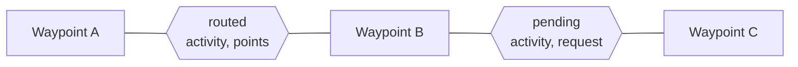
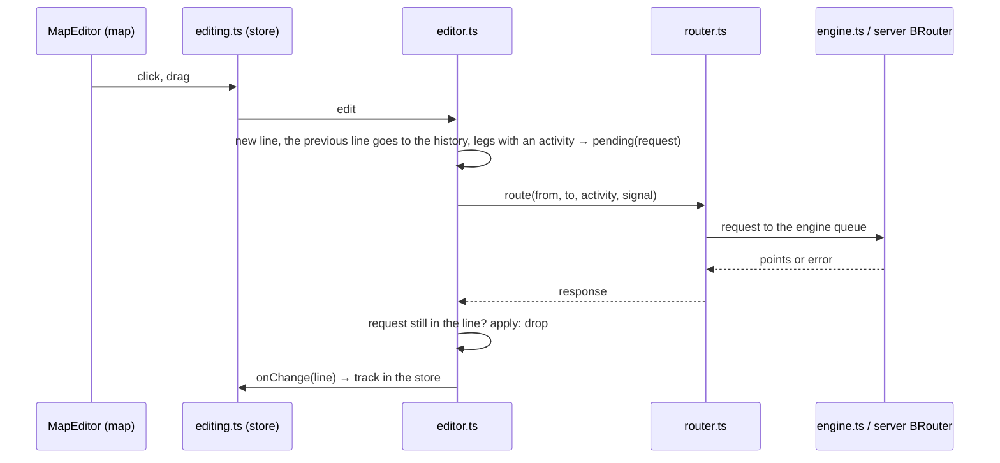
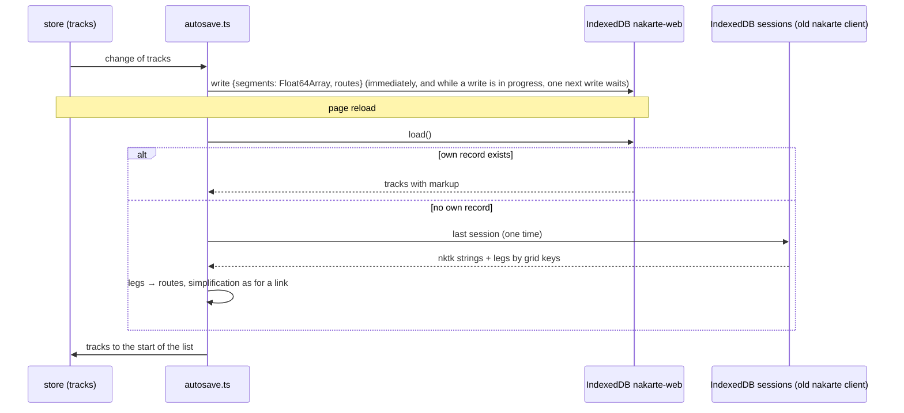

# Route editor

One level up: [overview](README.md#overview), block ①; client: [client.md](client.md).

How a track line keeps the waypoints and the route legs, and how the legs are routed and cancelled. Where the history is, and how the route markup stays after a reload and in a link. Behavior: specs [route-editing](../../openspec/specs/route-editing/spec.md) and [routing](../../openspec/specs/routing/spec.md). Decisions: archives [add-web-route-editor](../../openspec/changes/archive/2026-10-09-add-web-route-editor/design.md), [add-web-autosave](../../openspec/changes/archive/2026-10-09-add-web-autosave/design.md), [add-web-line-tools](../../openspec/changes/archive/2026-10-09-add-web-line-tools/design.md). Code: [web/src/routing/](../../web/src/routing/).

## Line model

An editor line is waypoints and legs between them. It is not a flat array of nodes with a mark on each node, as in the editor of the old nakarte client. The data is immutable: an edit gives a new line ([line.ts](../../web/src/routing/line.ts)).

- A leg (`Leg`) has one of these types:
  - `straight`: a straight line;
  - `routed`: the route points between the waypoints;
  - `pending`: waits for the router under a request number;
  - `failed`: not routed, a straight line with a mark and a toast; the activity stays for a retry.
- In a track, the line is stored as geometry (`segments`) and markup (`routes`), through `toSegment` and `fromSegment`. The markup is the waypoint indexes and the leg states without points. Autosave and the `nktk` link (an optional segment field of version 4) keep the markup. GPX and KML files keep only the geometry.
- Line simplification (`simplifyRouted`) simplifies each routed leg separately, together with its end waypoints, and calculates the indexes again: no waypoint disappears.

## Edits, requests and stale responses

The editor of one line, without the map, is [editor.ts](../../web/src/routing/editor.ts): `addWaypoint`, `moveWaypoint`, `insertWaypoint`, `removeWaypoint`, `shortcut`, `reverse`, `undo`, `redo`.

- A response applies only if its request number is still in the line. Otherwise, the user dragged, deleted or undid the leg, and the editor drops the response without a message. An `AbortController` cancels a request when its leg leaves the line. The queue of the calculations is in the engine ([routing.md](routing.md)).
- [editing.ts](../../web/src/routing/editing.ts) connects the editors to the store without React. An editor lives longer than the editing session: it waits for responses and keeps the history. The key of an editor is the point array of the segment that the editor wrote to the track last. An external change of the segment (reverse, deletion, import) gives a different array, and the app discards that editor.
- The line tools (Cut, Join, Shortcut, reverse) are pure functions on `RouteLine` ([line-tools.ts](../../web/src/routing/line-tools.ts)). The map menu and the long press on a phone: [MapMenu.tsx](../../web/src/routing/MapMenu.tsx), [MapEditor.tsx](../../web/src/routing/MapEditor.tsx).

## History

- Each edit puts the previous line on the undo stack (up to 100 steps, `HISTORY_LIMIT`) and clears redo. A router response does not go to the history: undo cancels an edit, not the arrival of a route.
- A snapshot from the history with pending legs requests them again.
- An insertion of a point on a leg and a drag immediately after it are one history step.
- The hotkeys use `keydown`: on macOS, while Cmd is pressed, the browser does not send `keyup` for other keys. The undo and redo buttons are in the editor panel.

## Route markup across reloads

- The coordinates are written exactly, without the nktk rounding: the markup indexes are correct as they are.
- The app imports the session of the old nakarte client only if there is no own record. The database `sessions` does not change (archive `switch-to-web-app`).

## Checked against

[web/src/routing/](../../web/src/routing/) (`line.ts`, `editor.ts`, `editing.ts`, `line-tools.ts`, `router.ts`), [web/src/autosave/](../../web/src/autosave/) (`autosave.ts`, `saved.ts`, `idb.ts`, `legacy-session.ts`): `master` after change `switch-to-web-app`.
