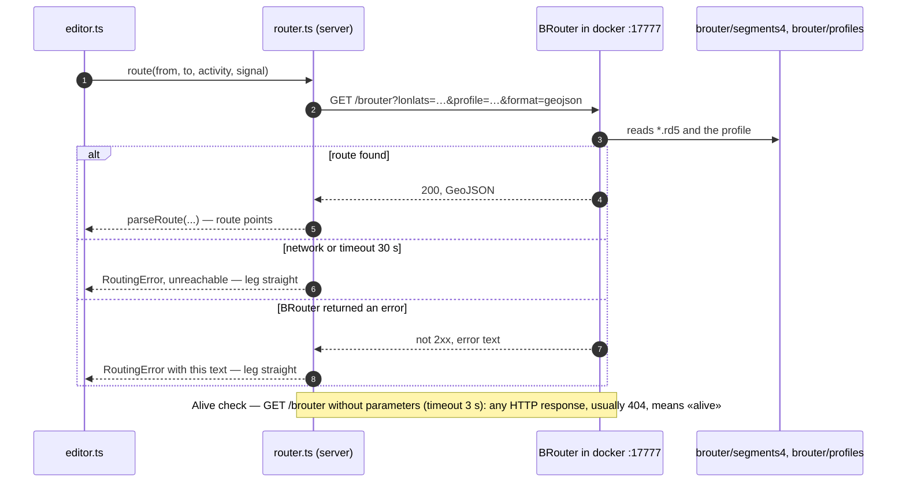
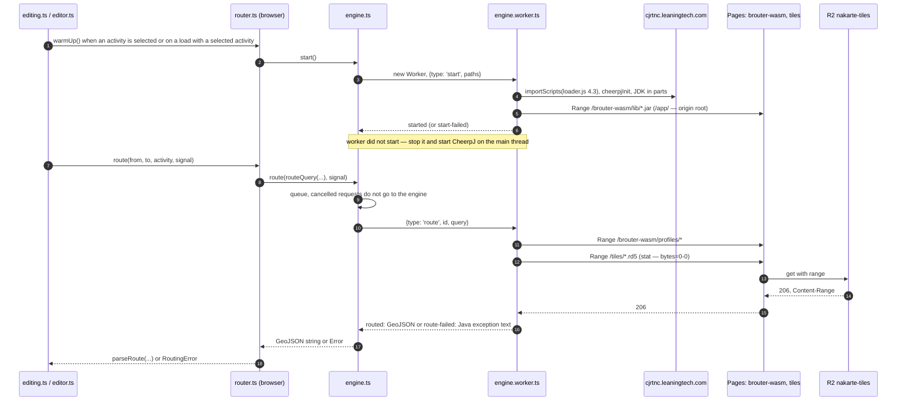

# Routing a leg

One level up: [overview](README.md#overview), blocks ②, ③ and ⑧.

How a leg between two waypoints becomes route points. The key `routingEngine` in [config.ts](../../web/src/config.ts) selects the engine by the Vite mode ([client.md](client.md)). Mode `clone` gives `'browser'`: BRouter on CheerpJ in the browser. The other modes give `'server'`: BRouter in docker. Both engines are behind the interface `Router` in [router.ts](../../web/src/routing/router.ts), and the editor gets the same result from both: the leg points or a `RoutingError`.

Behavior: specs [routing](../../openspec/specs/routing/spec.md) and [browser-routing-engine](../../openspec/specs/browser-routing-engine/spec.md). Code: [web/src/routing/](../../web/src/routing/) (request and response in `brouter.ts`, router in `router.ts`) and [web/src/engine/](../../web/src/engine/). How the editor calls the router and drops stale responses: [route-editor.md](route-editor.md).

## Shared steps

1. For each leg in the state `pending`, the editor ([route-editor.md](route-editor.md)) calls `router.route(from, to, activity, signal)`. When an edit removes a leg, an `AbortSignal` cancels its request, and the editor drops the rejection with `signal.reason` without a message.
2. `routeQuery` in [brouter.ts](../../web/src/routing/brouter.ts) builds the query string: `lonlats` (the longitude is brought to [−180, 180]), `profile` by the activity, `profile:<variable>` from the `params` of the activity, `alternativeidx=0`, `format=geojson`. The server and the engine use the same string.
3. The response is GeoJSON. `parseRoute` moves it to the world copy of the point `from`. Then it simplifies the line with the import tolerance (≈ 2.4 m) and drops the ends that are nearer than 20 m to the waypoints. An empty route is the error `no route found`.
4. A `RoutingError` with `unreachable` means that the server did not answer or the engine did not start. Then the button changes color, and a warning shows one time per change from "works" to "failed". Other errors give the notice `Routing failed`. The leg stays straight (spec routing, requirements ["A routing error gives a straight leg"](../../openspec/specs/routing/spec.md#requirement-ошибка-прокладки-даёт-прямой-отрезок) and ["Unreachable router"](../../openspec/specs/routing/spec.md#requirement-недоступный-роутер)). `isReachable` checks again if the router is alive when the routing menu opens.

When a BRouter tile is missing, BRouter says `datafile … not found`. `RoutingError` replaces this text with `no routing data for this area` for both engines (archive [explain-missing-routing-data](../../openspec/changes/archive/2026-10-07-explain-missing-routing-data/proposal.md)).

## Server BRouter

The request timeout is 30 s, without retries. The server address is `routingServer` in [config.ts](../../web/src/config.ts), and [docker-compose.yml](../../docker-compose.yml) starts BRouter. Custom profiles, the image tag and the compose pitfalls: `AGENTS.md`, ["Launch"](../../AGENTS.md#запуск).

## In-browser engine

Differences from the server:

- The engine is the singleton `getEngine()` in [engine.ts](../../web/src/engine/engine.ts), one per page. The app creates it lazily and starts it in advance.
- The requests go to a queue one at a time. A calculation longer than 60 s stops: the worker stops, and the next request starts a new worker. A blocked engine on the main thread is unreachable until its calculation ends ([add-engine-timeout](../../openspec/changes/archive/2026-10-12-add-engine-timeout/design.md)).
- The engine reads the BRouter files by HTTP Range from the same origin.

CheerpJ runs in a classic Web Worker ([engine.worker.ts](../../web/src/engine/engine.worker.ts)), and the main thread is free during the start and the calculation. If the worker does not start, the engine starts on the main thread in the same attempt ([backends.ts](../../web/src/engine/backends.ts), `mainThreadBackend`). Decisions and measurements: archive [spike-engine-in-worker](../../openspec/changes/archive/2026-10-08-spike-engine-in-worker/design.md).

- The routing button sees the engine state (`idle`, `loading`, `ready`, `failed`) through `router.status()` and `subscribe`. A start failure does not stay: the next route tries to start the engine again. While the state is `failed`, the router is unreachable (`EngineStartError` → `RoutingError` with `unreachable`).
- You cannot stop a CheerpJ calculation that has started. A cancelled request gets a rejection immediately, and the next request waits until the engine is free.
- The engine paths are `enginePaths` in [cheerpj-router.ts](../../web/src/engine/cheerpj-router.ts): the classpath `brouter-patch.jar:brouter.jar:wasm-router.jar` from `/app/brouter-wasm/lib/`, the profiles from `/app/brouter-wasm/profiles/`, the tiles from `/app` + `routingTilesPath` (`/tiles/` in mode `clone`). The CheerpJ wrapper code is in the worker and also in `cheerpj-router.ts`: in the Vite dev mode, a classic worker imports nothing.

How the reads of `/app/` work, and why the patches are necessary:

- CheerpJ sees `/app/` as files from the root of the page origin. There are no directories there. The size comes from `Content-Range` of the response to `Range: bytes=0-0`, so static files without `206` do not work. [functions/brouter-wasm](../../functions/brouter-wasm/[[path]].js) answers Range for the jar and the profiles, and [functions/tiles](../../functions/tiles/[[path]].js) on top of [workers/tiles/src/index.js](../../workers/tiles/src/index.js) answers it for the tiles. The build plugin `engineFiles` ([engine-files.ts](../../web/vite/engine-files.ts)) puts the jar and the profiles in `build/brouter-wasm/`. The dev server and `vite preview` serve them with Range themselves.
- `NodesCache.java` in [patch/](../../experiments/wasm/cheerpj/patch/btools/mapaccess/) skips the check of the segment directory. `OsmNodesMap.java` catches a stack overflow, which CheerpJ sends as `ArithmeticException`. The patches are built into `brouter-patch.jar`, which is first in the classpath ([build.sh](../../experiments/wasm/cheerpj/build.sh)).
- `WasmRouter` ([WasmRouter.java](../../experiments/wasm/cheerpj/java/WasmRouter.java)) repeats the BRouter `RouteServer` without sockets.

Details and the pitfalls that we found in practice: `AGENTS.md`, ["In-browser engine (CheerpJ)"](../../AGENTS.md#движок-в-браузере-cheerpj). The engine requirements are in the spec browser-routing-engine: ["One engine per page"](../../openspec/specs/browser-routing-engine/spec.md#requirement-один-движок-на-страницу), ["Request queue"](../../openspec/specs/browser-routing-engine/spec.md#requirement-очередь-запросов), ["Engine data from the origin root"](../../openspec/specs/browser-routing-engine/spec.md#requirement-данные-движка-от-корня-origin), ["Runtime from the Leaning Technologies CDN"](../../openspec/specs/browser-routing-engine/spec.md#requirement-рантайм-с-cdn-leaning-technologies), ["Route calculation outside the main thread"](../../openspec/specs/browser-routing-engine/spec.md#requirement-расчёт-маршрута-вне-главного-потока). The measurement bench is `/engine-bench.html` ([engine-bench.ts](../../web/src/bench/engine-bench.ts)). Where the tiles in R2 come from: [ci-cd.md](ci-cd.md). Engine measurements and alternatives: [backlog, "Browser engine options"](../../openspec/backlog.md#варианты-движка-в-браузере).

## Checked against

[web/src/routing/router.ts](../../web/src/routing/router.ts), [web/src/routing/brouter.ts](../../web/src/routing/brouter.ts), [web/src/routing/editing.ts](../../web/src/routing/editing.ts) (`onRouteError`, `setActivity`, `warmUp`, `checkRouter`), [web/src/routing/editor.ts](../../web/src/routing/editor.ts) (`request`), [web/src/engine/](../../web/src/engine/), [web/src/config.ts](../../web/src/config.ts), [web/src/App.tsx](../../web/src/App.tsx) (`createRouter`), [web/vite/engine-files.ts](../../web/vite/engine-files.ts), [functions/](../../functions/), [workers/tiles/src/index.js](../../workers/tiles/src/index.js), [experiments/wasm/cheerpj/build.sh](../../experiments/wasm/cheerpj/build.sh), [docker-compose.yml](../../docker-compose.yml).
