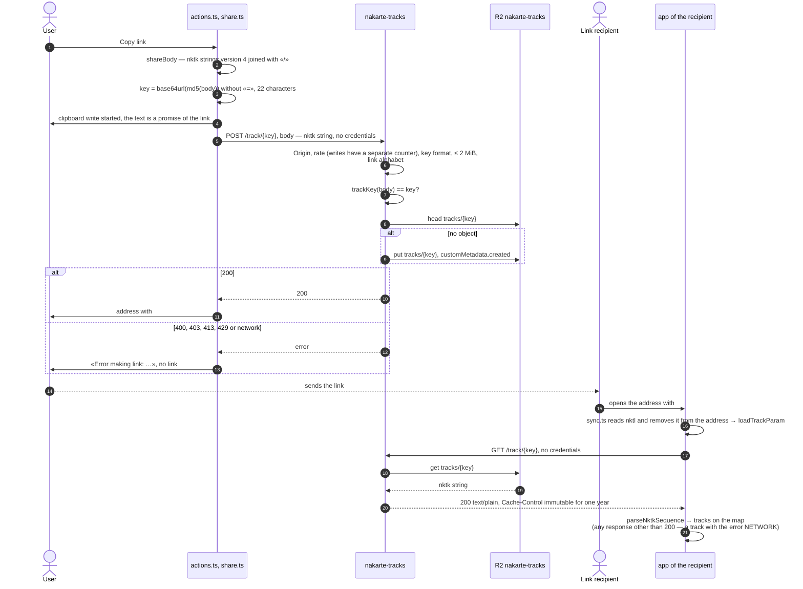

# Track storage: the `nktl=` link

One level up: [overview](README.md#overview), block ⑤.

A short link to tracks: the address has only a key, and the Worker `nakarte-tracks` ([workers/tracks](../../workers/tracks/)) keeps the tracks in R2. The contract repeats the author's `tracks.nakarte.me`: the body is the same `nktk` strings, and the key is the same hash. Thus the `nktl=` links that the author's service gave before still open. Behavior: spec [track-storage](../../openspec/specs/track-storage/spec.md). Decisions: archive [add-track-storage](../../openspec/changes/archive/2026-10-07-add-track-storage/design.md); the client part: archive [add-web-tracks](../../openspec/changes/archive/2026-10-08-add-web-tracks/design.md).

## From "Copy link" to the opened link

- The link goes to the clipboard only after a `200` from the storage. The app gives the clipboard a promise of the text. If the `POST` fails, the user has no link but gets a notice. The old nakarte client gave the link before the server response: archive add-web-tracks, ["The link comes after the storage response"](../../openspec/changes/archive/2026-10-08-add-web-tracks/design.md#ссылка--после-ответа-хранилища).
- The key is a hash of the content, so the object does not change, and a second write is not necessary. The Worker calculates the key with the same `blueimp-md5` as the client ([key.js](../../workers/tracks/src/key.js), `trackKey` in [share.ts](../../web/src/tracks/share.ts)).
- The route markup goes into the link as an optional segment field in the `nktk` string version 4 (schema: [nktk.proto](../../web/src/tracks/nktk.proto), [route-editor.md](route-editor.md)). The Worker does not parse the body. The app reads all `nktk` versions from 1 to 4 ([nktk.ts](../../web/src/tracks/nktk.ts)): the links that users already have and the storage objects depend on them.
- The link address is the current app address without the search (`q`, `r`) and without the track parameters; `nktl` takes their place (`shareLink`).
- The old `nktl=` links depend on this storage. This is important when the Workers get new names: [backlog, "Global direction"](../../openspec/backlog.md#глобальное-направление-полная-автономия).

## Checked against

[web/src/tracks/share.ts](../../web/src/tracks/share.ts) (`shareBody`, `trackKey`, `shareLink`, `storeTracks`), [web/src/tracks/actions.ts](../../web/src/tracks/actions.ts) (`copyLink`), [web/src/tracks/links.ts](../../web/src/tracks/links.ts) (`fromStorage`, `loadTrackParam`), [web/src/tracks/nktk.ts](../../web/src/tracks/nktk.ts) (`saveNktk`, `parseNktkSequence`), [web/src/state/sync.ts](../../web/src/state/sync.ts), [workers/tracks/src/index.js](../../workers/tracks/src/index.js), [workers/tracks/src/key.js](../../workers/tracks/src/key.js), [workers/tracks/wrangler.toml](../../workers/tracks/wrangler.toml).
